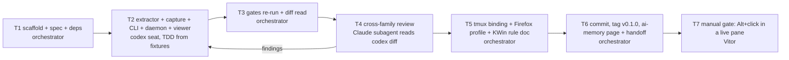

# mermaid-peek — plan

| Decision | Alternatives considered | Consequence |
|---|---|---|
| One codex run implements the whole tool from a single brief | Split into extractor and daemon runs | The pieces are small and share types; one brief keeps them coherent; the brief names every file |
| Reviewer is a Claude subagent (different family from codex) | opencode verify-alt (Kimi) | Kimi is fine too, but Claude is already in session and reads TypeScript well |
| Orchestrator installs the tmux binding and Firefox profile, not the seat | Seat edits `~/.config/tmux` | Seat stays inside the worktree; config edits are user-visible state changes owned by the orchestrator |

| Task | Seat | Gate | Ledger entry |
|---|---|---|---|
| T1 — scaffold repo, spec, plan, package.json, `npm install` | orchestrator | `ls node_modules/mermaid/dist/mermaid.min.js` | progress.md |
| T2 — implement per `_brief-impl.md` | codex exec (workspace-write) | seat self-check: `npm test`, `node_modules/.bin/tsc --noEmit` | thread_id + files changed |
| T3 — re-run gates, read diff, scratch-leak check | orchestrator | same commands, plus `bin/mermaid-peek extract < fixture` | outputs |
| T4 — adversarial review of the diff | Claude subagent | verdict + findings, ≤5 fix rounds | findings and their fate |
| T5 — tmux snippet, `source-file`, Firefox profile dir, README KWin rule | orchestrator | `tmux list-keys -T root M-MouseDown1Pane` | output |
| T6 — commit, tag, ai-memory | orchestrator | `git log`, `memory_write_page` id | ids |
| T7 — Alt+click on a real diagram | Vitor | diagram visible in viewer | Vitor's confirmation |
