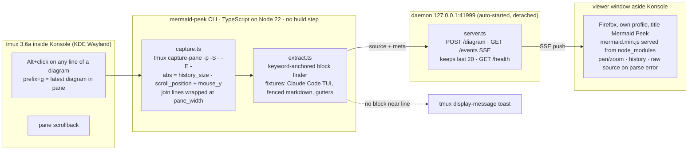

# mermaid-peek — render the mermaid block under the pointer, aside the terminal



| Decision | Alternatives considered | Consequence |
|---|---|---|
| Trigger = **Alt+click** on a diagram line (`M-MouseDown1Pane`), plus `prefix + g` for the latest diagram in the pane | Hover (tmux exposes no pointer-motion binding, verified on 3.6a); Shift+click (Konsole keeps Shift+click for native selection, never forwards it); Ctrl+click (user chose Alt) | Alt+click anywhere else is harmless: a toast says no diagram was found |
| Language = **TypeScript run directly by Node 22** (`--experimental-strip-types`), `node --test`, `tsc --noEmit` as the type gate | Rust (no toolchain on the box; every mermaid renderer is JS so Rust would shell out to Node anyway); Go | One runtime already installed; zero build step; codex implements it cheaply |
| Renderer/surface = **Firefox window running the real mermaid.js** (all diagram types, identical to GitHub/Linear rendering) | ASCII in a tmux side pane via beautiful-mermaid (6 diagram types, poor for wide graphs); sixel image in a tmux pane (tmux+sixel redraw flakiness) | The diagram lives in a desktop window next to Konsole; a KWin rule matching title "Mermaid Peek" parks it on the right half; `--ascii` can be added later |
| Block detection anchors on a **mermaid diagram keyword line**, expands while indentation holds, strips common indent and TUI gutters | Requiring ``` fences (Claude Code strips them and prints a `mermaid` label plus 4-space indent) | Works on rendered TUI output, not only on raw markdown |
| Line addressing captures **without `-J`** and re-joins wrapped lines by `pane_width` in code | `capture-pane -J` (joins wrapped lines, which shifts every index after the first wrap) | `mouse_y` maps exactly to the captured line; joined text is what the renderer receives |
| Daemon is **auto-started by the click command** and bound to 127.0.0.1 only | systemd user unit; always-on | Nothing to remember to start; `mermaid-peek status` says whether it is alive |

## Scope

- In: CLI (`click`, `latest`, `extract`, `serve`, `open`, `status`, `install-tmux`), extractor with fixtures, SSE daemon, viewer page, tmux binding snippet, README with the KWin rule.
- Out: ASCII/sixel rendering, other terminals or multiplexers, systemd unit, editing diagrams in the viewer, persistence across daemon restarts.
- Operation: Vitor runs it on the laptop. Observe with `mermaid-peek status` (daemon pid, port, connected viewers, last render), `~/.local/state/mermaid-peek/daemon.log`, and the tmux toast printed on every trigger ("mermaid-peek: flowchart, 22 lines → viewer" or "no diagram near line N").

## Gates per stage

| Stage | Gate | Expected evidence |
|---|---|---|
| architect/research | Environment probes (terminal, tmux mouse keys, renderers) | Recorded in this spec's ADR table and in ai-memory |
| development | `npm test` (extract fixtures, wrap-join, locate math, server smoke) and `node_modules/.bin/tsc --noEmit` | Both green, re-run by the orchestrator after the seat finishes |
| deployment to dev | `bin/mermaid-peek serve` on a free port, `curl /health` | JSON with pid, port, clients |
| e2e | `bin/mermaid-peek extract < test/fixtures/claude-code-tui.txt` prints the flowchart; POST it and watch `/events` deliver it; Firefox window renders it | Output captured in the ledger |
| CI | none yet (personal tool, no remote) | ledger notes the gap |
| CD | tmux snippet sourced from `~/.config/tmux/tmux.conf`, `tmux source-file` reloaded | `tmux list-keys -T root M-MouseDown1Pane` shows the binding |
| release | git tag `v0.1.0` on main | tag present |
| post-release check | Manual: Alt+click on a diagram in a live Claude Code pane shows it in the viewer within ~1 s | Vitor confirms |

## Risks and rollback

- Alt+click may be swallowed by KWin or Konsole before tmux sees it. Signal: no toast at all. Owner: Vitor. Rollback/alternative: change the snippet to `C-MouseDown1Pane`; nothing else changes.
- Claude Code may change how it prints code blocks. Signal: toast says "no diagram" on a visible diagram. Fix: add a fixture from `tmux capture-pane -p` and adjust `extract.ts`; the `extract` subcommand reads stdin for exactly this.
- Firefox first-run noise in the dedicated profile. Signal: welcome tabs. Mitigation: `user.js` written by `open` before first launch.
- Removing the tool: delete the `source-file` line from `tmux.conf`, `tmux source-file`, remove `~/Projects/mermaid-peek`, `~/.local/share/mermaid-peek`, `~/.local/state/mermaid-peek`.
